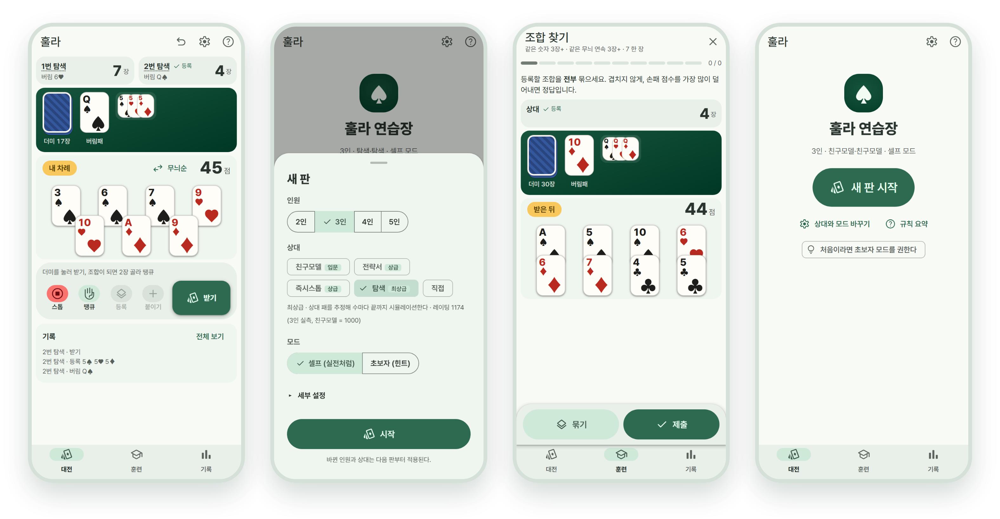

<div align="center">

<picture>
  <source media="(prefers-color-scheme: dark)" srcset="docs/readme/logo/hoola-lockup-dark.svg">
  <source media="(prefers-color-scheme: light)" srcset="docs/readme/logo/hoola-lockup-light.svg">
  
</picture>

<p>
  <b>실력이 숫자로 보이는 봇들과 훌라를 연습하는 곳.</b><br>
  Rust 규칙 엔진과 AI를 WebAssembly로 브라우저 안에서 돌립니다. 서버도 계정도 없고, 오프라인에서도 됩니다.
</p>

<p>
  <a href="https://github.com/lowqen/hoola-ai/actions/workflows/ci.yml"></a>
  <a href="https://lowqen.github.io/hoola-ai/"></a>
  <a href="#라이선스"></a>
  
  
  
</p>

</div>

<p align="center">
  <a href="https://lowqen.github.io/hoola-ai/">
    <picture>
      <source media="(prefers-color-scheme: dark)" srcset="docs/readme/badges/play-ko-dark.svg">
      
    </picture>
  </a>
  <a href="RULES.md">
    <picture>
      <source media="(prefers-color-scheme: dark)" srcset="docs/readme/badges/rules-ko-dark.svg">
      
    </picture>
  </a>
  <a href="README.md">
    <picture>
      <source media="(prefers-color-scheme: dark)" srcset="docs/readme/badges/readme-en-dark.svg">
      
    </picture>
  </a>
</p>

## <picture><source media="(prefers-color-scheme: dark)" srcset="docs/readme/sections/screens-dark.svg"></picture> 화면

<picture>
  <source media="(prefers-color-scheme: dark)" srcset="docs/readme/showcase-dark.png">
  
</picture>

<p align="center"><sub>왼쪽부터 대전 중인 판, 상대 고르기, 훈련 문제, 홈.</sub></p>

---

## <picture><source media="(prefers-color-scheme: dark)" srcset="docs/readme/sections/features-dark.svg"></picture> 기능

<table>
  <tr>
    <td width="50%" valign="top">
      <p>
        <picture>
          <source media="(prefers-color-scheme: dark)" srcset="docs/readme/features/cards-dark.svg">
          
        </picture>
        <br><b>실전처럼 두는 대전</b>
      </p>
      <p>
        2~5인. 기본은 셀프 모드라 등록·붙이기·땡큐·스톱을 스스로 찾아야 하고, 오프라인처럼 버림패는
        맨 위 한 장만 보입니다. 초보자 모드는 가능한 수를 버튼으로 보여 주고 힌트를 켭니다.
        되돌리기와 같은 패 다시 두기도 됩니다.
      </p>
    </td>
    <td width="50%" valign="top">
      <p>
        <picture>
          <source media="(prefers-color-scheme: dark)" srcset="docs/readme/features/trophy-dark.svg">
          
        </picture>
        <br><b>실력이 보이는 봇</b>
      </p>
      <p>
        실제 친구를 본뜬 모델부터 탐색 봇까지 7종. 행동을 나타내는 이름과 난이도 배지, 지금 인원과
        규칙에서 실측한 레이팅이 붙어 있어 이겼을 때 그게 얼마나 대단한지 알 수 있습니다.
      </p>
    </td>
  </tr>
  <tr>
    <td width="50%" valign="top">
      <p>
        <picture>
          <source media="(prefers-color-scheme: dark)" srcset="docs/readme/features/target-dark.svg">
          
        </picture>
        <br><b>훈련 모드</b>
      </p>
      <p>
        조합 찾기 · 땡큐 찾기 · 스톱 판단 · 버릴 카드. 문제는 엔진이 실제 판 장면에서 만들고 정답도
        엔진이 매깁니다. 약한 유형이 더 자주 나오고, 틀린 문제는 두 번 맞힐 때까지 오답 노트에 남습니다.
      </p>
    </td>
    <td width="50%" valign="top">
      <p>
        <picture>
          <source media="(prefers-color-scheme: dark)" srcset="docs/readme/features/review-dark.svg">
          
        </picture>
        <br><b>판 복기</b>
      </p>
      <p>
        결정마다 시뮬레이션 승률 흐름을 그리고, 확실한 실수만 부정확·실수·블런더로 짚습니다. 이유,
        그 순간의 장면, 더 나은 수, "이 장면부터 다시 두기"까지. 스톱 기준표대로 둔 스톱은 실수로 세지 않습니다.
      </p>
    </td>
  </tr>
  <tr>
    <td width="50%" valign="top">
      <p>
        <picture>
          <source media="(prefers-color-scheme: dark)" srcset="docs/readme/features/chip-dark.svg">
          
        </picture>
        <br><b>엔진이 브라우저 안에서</b>
      </p>
      <p>
        실험에 쓰는 Rust 엔진을 그대로 WebAssembly로 빌드했습니다. 봇의 수, 힌트, 복기 계산은 모두
        기기 안의 웹 워커에서 돌아서 화면이 멈추지 않습니다.
      </p>
    </td>
    <td width="50%" valign="top">
      <p>
        <picture>
          <source media="(prefers-color-scheme: dark)" srcset="docs/readme/features/offline-dark.svg">
          
        </picture>
        <br><b>오프라인, 기록은 내 기기에</b>
      </p>
      <p>
        앱으로 설치하면 인터넷 없이도 됩니다. 전적과 모든 판의 리플레이는 브라우저에만 저장되고
        JSON으로 내보낼 수 있습니다.
      </p>
    </td>
  </tr>
</table>

---

## <picture><source media="(prefers-color-scheme: dark)" srcset="docs/readme/sections/cards-dark.svg"></picture> 규칙 한눈에

조커 없는 52장으로 하는 오프라인 친구 대전용 캐주얼 룰입니다. 단판 승패이고 점수 정산·판돈·박이 없습니다.

- **준비**: 2~5인, 각자 7장. 자기 차례에 더미에서 받거나(또는 땡큐) 등록·붙이기를 하고 한 장 버립니다.
- **등록**: 같은 숫자 3장 이상, 또는 같은 무늬 연속 3장 이상. A는 어디든 이어지고(Q-K-A-2), **7은 한 장만으로** 등록됩니다.
- **땡큐**: 바로 앞 사람이 방금 버린 카드가 내 손패 2장과 새 조합이 되면 가져와 등록합니다.
- **스톱**: 차례 시작에 손패 점수가 10점 이하면(A=1, J·Q·K=11·12·13) 선언합니다. 내가 **혼자 가장 낮아야** 이깁니다.
- **털기**: 손패를 다 털면 그 자리에서 이깁니다.

판정표와 엣지 케이스까지 담은 전체 명세는 [RULES.md](RULES.md), 처음 배운다면 [TRAINING.md](TRAINING.md)부터.

---

## <picture><source media="(prefers-color-scheme: dark)" srcset="docs/readme/sections/bots-dark.svg"></picture> 봇과 레이팅

레이팅은 시드 고정 교차 대국으로 쟀습니다. 모든 봇 쌍이 같은 딜을 자리만 바꿔 두므로 카드 운이 상쇄됩니다.
Bradley–Terry로 맞추고 친구모델을 1000으로 두었습니다. 2인에서 +100점은 맞대결 약 64%입니다.

| 봇 | 배지 | 두는 법 | 2인 | 2인 스톱 5점 | 3인 | 4인 | 5인 |
|---|---|---|---:|---:|---:|---:|---:|
| 탐색 | 최상급 | 버림·넘김으로 상대 패를 추정해 수마다 끝까지 시뮬레이션 | **1164** | **1129** | **1174** | **1185** | **1188** |
| 전략서 | 상급 | [STRATEGY.md](STRATEGY.md)의 스톱 기준표와 등록·버림 원칙대로 | 1134 | 1091 | 1148 | 1155 | 1167 |
| 즉시스톱 | 상급 | 스톱할 수 있으면 바로 스톱 | 1103 | 1052 | 1107 | 1114 | 1132 |
| 노스톱 | 보통 | 스톱 없이 털기만 노린다 | 1026 | 1008 | 1062 | 1084 | 1099 |
| 늦은스톱 | 보통 | 등록을 미루고 2점 이하 스톱 | 1040 | 1022 | 1050 | 1050 | 1043 |
| 친구모델 | 입문 | 실제 친구 모델. 모아서 한 번에 등록, 스톱할 수 있으면 바로 스톱 | 1000 | 1000 | 1000 | 1000 | 1000 |
| 한방털기 | 입문 | 스톱 없이 털 때만 등록 | 971 | 981 | 980 | 979 | 985 |

오차는 최대 ±10. 측정 방법과 전체 표: [docs/lab/2026-11-21-bot-rating.md](docs/lab/2026-11-21-bot-rating.md)

---

## <picture><source media="(prefers-color-scheme: dark)" srcset="docs/readme/sections/search-dark.svg"></picture> 탐색 봇은 이렇게 둔다

신경망 없이 결정화 몬테카를로 탐색(PIMC)을 씁니다.

1. **숨은 패 추정**: 지금까지 본 것과 모순되지 않는 상대 손패를 뽑습니다. 학습된 랭크 표로 가중하고,
   공개 행동을 베이즈 증거로 씁니다. 땡큐할 수 있었는데 안 했다면 그 카드와 맞는 패는 없을 가능성이 크고,
   방금 버린 카드 근처의 카드도 덜 들고 있다고 봅니다.
2. **끝까지 두어 보기**: 추정한 판마다 모든 후보 수를 빠른 롤아웃 봇으로 판 끝까지 둡니다. 결정마다 256판.
3. **확실할 때만 바꾸기**: 전략서 봇의 수에서 출발해, 짝지은 이득이 표준오차의 0.5배를 넘을 때만 바꿉니다.

전략서 봇을 상대로 (2인):

| | 승률 | Elo |
|---|---:|---:|
| R1 전 탐색 봇 | 51.2% | +8 |
| **지금 탐색 봇** (등록 탐색, 베이즈 추론, z = 0.5, k = 256) | **55.2%** | **+36** |
| 모든 손패를 보는 반칙 봇 (상한, R0) | 66.0% | +115 |

남은 차이는 대부분 상대의 숨은 패에서 나오는데, 공개된 플레이로는 거의 드러나지 않습니다.
실험 기록: [R0 천장](docs/lab/2026-11-21-r0-ceiling.md), [R1 탐색](docs/lab/2026-11-21-r1-search.md), 그 밖의 [docs/lab](docs/lab)

---

## <picture><source media="(prefers-color-scheme: dark)" srcset="docs/readme/sections/dev-dark.svg"></picture> 개발

| 경로 | 내용 |
|---|---|
| [`crates/hoola-core`](crates/hoola-core) | 규칙 엔진 (상태기계, 관측 API, 프리셋, 리플레이), 봇 L0–L3, 대전 진행기. 명세 테스트는 `tests/rules_spec.rs` |
| [`crates/hoola-wasm`](crates/hoola-wasm), [`web`](web) | WASM 바인딩과 SvelteKit 연습장 |
| [`crates/hoola-lab`](crates/hoola-lab) | 전략 실험: 친구 페르소나(`--only F`), L3 헤드룸(`--only L3`), 레이팅(`--only R`), 천장(`--only R0`), 탐색 후보(`--only R1`) |
| [`crates/hoola-sim`](crates/hoola-sim) | 봇 대전 시뮬레이션 CLI (듀플리케이트, 승률 95% CI, 초당 판 수) |
| [`crates/hoola-py`](crates/hoola-py) | Python 바인딩 (`import hoola`, maturin · abi3 wheel) |
| [`config/presets`](config/presets) | 규칙 프리셋. 기본은 [`offline_casual.toml`](config/presets/offline_casual.toml) |

```sh
cargo test --workspace --all-targets                       # 엔진, 봇, 규칙 명세
cargo run --release -p hoola-sim -- --players 3 --bots expert,greedy

# 연습장
wasm-pack build crates/hoola-wasm --target web --out-dir ../../web/static/pkg
cd web && npm ci && npm run dev
```

빌드 없이 오프라인으로 열려면 (Windows):

```powershell
powershell -ExecutionPolicy Bypass -File scripts/practice.ps1   # 최신 CI 빌드를 받아 http://localhost:8765 로 연다
```

푸시마다 CI가 Rust 테스트, rustfmt·Clippy, WASM 빌드, Playwright E2E, Lighthouse, JS 용량 예산을 검사하고,
`main` 푸시는 GitHub Pages에 배포합니다. 무거운 실험은 `gh workflow run ci.yml -f experiment=…`로 수동 실행합니다.

### 문서

| | |
|---|---|
| [RULES.md](RULES.md) | 규칙 명세, 엣지 케이스, 설정 키 |
| [STRATEGY.md](STRATEGY.md) | 전략서: 스톱 기준표, 2인·3인 운영, 친구 상대 분석 |
| [TRAINING.md](TRAINING.md) | 입문자 실력 향상 계획 (단계별 설정·외울 것·통과 기준) |
| [ROADMAP.md](ROADMAP.md) | 계획과 참고 연구 (Suphx, Pluribus, ReBeL 등) |
| [docs/DESIGN_PLAN.md](docs/DESIGN_PLAN.md) | 디자인 개편(M3) 계획 |
| [docs/lab](docs/lab) | 실험 기록 |

보안 제보: [SECURITY.md](SECURITY.md)

---

## <picture><source media="(prefers-color-scheme: dark)" srcset="docs/readme/sections/license-dark.svg"></picture> 라이선스

[MIT](LICENSE). README 그림의 글자는 Inter와 Noto Sans KR(SIL Open Font License)로 그렸습니다.
