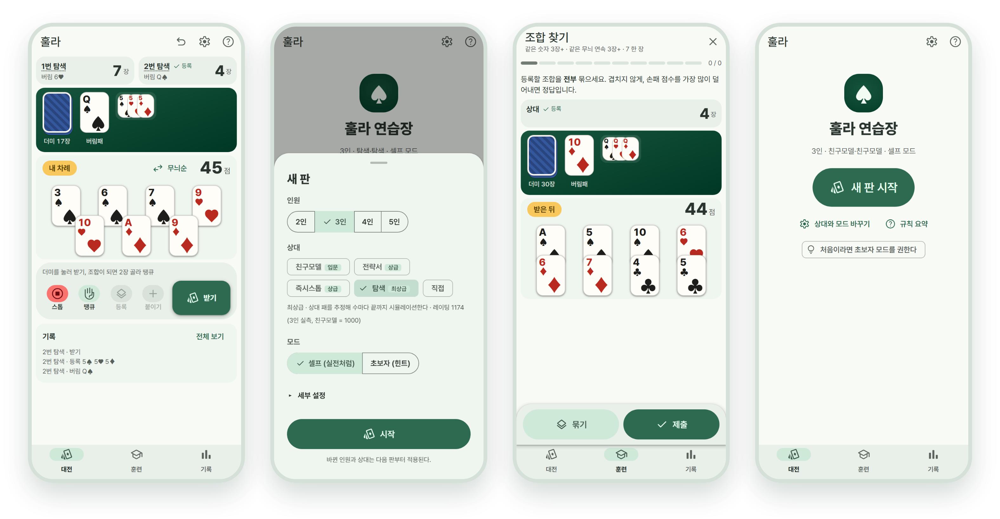

<div align="center">

<picture>
  <source media="(prefers-color-scheme: dark)" srcset="docs/readme/logo/hoola-lockup-dark.svg">
  <source media="(prefers-color-scheme: light)" srcset="docs/readme/logo/hoola-lockup-light.svg">
  
</picture>

<p>
  <b>Practise Hoola (훌라), the Korean rummy game, against bots that show how strong they are.</b><br>
  A Rust rules engine and AI, compiled to WebAssembly. It runs in your browser: no server, no account, works offline.
</p>

<p>
  <a href="https://github.com/lowqen/hoola-ai/actions/workflows/ci.yml"></a>
  <a href="https://lowqen.github.io/hoola-ai/"></a>
  <a href="#licence"></a>
  
  
  
</p>

</div>

<p align="center">
  <a href="https://lowqen.github.io/hoola-ai/">
    <picture>
      <source media="(prefers-color-scheme: dark)" srcset="docs/readme/badges/play-en-dark.svg">
      
    </picture>
  </a>
  <a href="RULES.md">
    <picture>
      <source media="(prefers-color-scheme: dark)" srcset="docs/readme/badges/rules-en-dark.svg">
      
    </picture>
  </a>
  <a href="README.ko.md">
    <picture>
      <source media="(prefers-color-scheme: dark)" srcset="docs/readme/badges/readme-ko-dark.svg">
      
    </picture>
  </a>
</p>

## <picture><source media="(prefers-color-scheme: dark)" srcset="docs/readme/sections/screens-dark.svg"></picture> Screenshots

<picture>
  <source media="(prefers-color-scheme: dark)" srcset="docs/readme/showcase-dark.png">
  
</picture>

<p align="center"><sub>The practice app is in Korean. From left: a game in progress, choosing opponents, a training drill, home.</sub></p>

---

## <picture><source media="(prefers-color-scheme: dark)" srcset="docs/readme/sections/features-dark.svg"></picture> Features

<table>
  <tr>
    <td width="50%" valign="top">
      <p>
        <picture>
          <source media="(prefers-color-scheme: dark)" srcset="docs/readme/features/cards-dark.svg">
          
        </picture>
        <br><b>Play like a real table</b>
      </p>
      <p>
        2 to 5 players. By default nobody tells you what is legal: you find melds, attachments,
        thank-yous and stops yourself, and only the top discard is visible, as at a real table.
        A beginner mode lists the legal moves and turns on hints. Undo, replay the same deal.
      </p>
    </td>
    <td width="50%" valign="top">
      <p>
        <picture>
          <source media="(prefers-color-scheme: dark)" srcset="docs/readme/features/trophy-dark.svg">
          
        </picture>
        <br><b>Bots with measured strength</b>
      </p>
      <p>
        Seven opponents, from a model of a real friend to a search bot. Each one has a name for how
        it plays, a level badge, and a rating measured for your player count and rule set,
        so you know what a win against it means.
      </p>
    </td>
  </tr>
  <tr>
    <td width="50%" valign="top">
      <p>
        <picture>
          <source media="(prefers-color-scheme: dark)" srcset="docs/readme/features/target-dark.svg">
          
        </picture>
        <br><b>Training drills</b>
      </p>
      <p>
        Find the melds, spot the thank-you, decide to stop, pick the discard. The engine builds each
        question from a real game position and checks your answer. Weak spots come back more
        often, and missed questions go to a notebook until you get them right twice.
      </p>
    </td>
    <td width="50%" valign="top">
      <p>
        <picture>
          <source media="(prefers-color-scheme: dark)" srcset="docs/readme/features/review-dark.svg">
          
        </picture>
        <br><b>Game review</b>
      </p>
      <p>
        After a game, every decision gets a simulated win rate. Only clear mistakes are flagged,
        with the reason, the position, the better move, and a button to replay from there.
        A stop that follows the stop table never counts as a mistake.
      </p>
    </td>
  </tr>
  <tr>
    <td width="50%" valign="top">
      <p>
        <picture>
          <source media="(prefers-color-scheme: dark)" srcset="docs/readme/features/chip-dark.svg">
          
        </picture>
        <br><b>The engine runs in your browser</b>
      </p>
      <p>
        The same Rust engine that runs the experiments is compiled to WebAssembly. Bots, hints and
        reviews are computed on your device in a web worker, so the screen never freezes.
      </p>
    </td>
    <td width="50%" valign="top">
      <p>
        <picture>
          <source media="(prefers-color-scheme: dark)" srcset="docs/readme/features/offline-dark.svg">
          
        </picture>
        <br><b>Offline and private</b>
      </p>
      <p>
        Install it as an app and it works without a connection. Records and full replays of every
        game stay in your browser, and you can export them as JSON.
      </p>
    </td>
  </tr>
</table>

---

## <picture><source media="(prefers-color-scheme: dark)" srcset="docs/readme/sections/cards-dark.svg"></picture> What is Hoola?

Hoola is a rummy game played in Korea with a standard 52-card deck and no jokers. This project
plays the casual offline rules: one hand, one winner, no scoring or stakes.

- **Deal**: 7 cards each, 2 to 5 players. On your turn you draw from the stock (or take the discard
  with a *thank-you*), meld or attach if you can, then discard.
- **Melds**: three or more of a rank, or a run of three or more in one suit (A wraps:
  Q-K-A-2 is a run). A single **7** is a meld on its own.
- **Thank-you (땡큐)**: take the card the previous player just discarded, if it completes a new meld
  with two cards from your hand.
- **Stop (스톱)**: at the start of your turn, with 10 points or fewer in hand (A = 1, J/Q/K = 11/12/13),
  call stop. You win only if your hand is strictly the lowest.
- **Going out**: empty your hand and you win at once.

The full specification, with edge cases and config keys, is [RULES.md](RULES.md) (in Korean).

---

## <picture><source media="(prefers-color-scheme: dark)" srcset="docs/readme/sections/bots-dark.svg"></picture> The bots

Ratings come from fixed-seed cross play: every pair of bots plays the same deals with the seats
swapped, so the luck of the cards cancels out. They are fitted with Bradley–Terry and anchored at
the friend model = 1000; in 2-player games, +100 means winning about 64% head to head.

| Bot | Level | How it plays | 2p | 2p stop 5 | 3p | 4p | 5p |
|---|---|---|---:|---:|---:|---:|---:|
| 탐색 · Search | Top | Infers your hand from your discards and passes, then simulates every candidate move to the end | **1164** | **1129** | **1174** | **1185** | **1188** |
| 전략서 · Strategy book | Strong | Follows [STRATEGY.md](STRATEGY.md): the stop table, melding and discard rules | 1134 | 1091 | 1148 | 1155 | 1167 |
| 즉시스톱 · Instant stop | Strong | Stops the moment it can | 1103 | 1052 | 1107 | 1114 | 1132 |
| 노스톱 · No stop | Medium | Never stops, plays only to go out | 1026 | 1008 | 1062 | 1084 | 1099 |
| 늦은스톱 · Late stop | Medium | Holds melds back and stops at 2 points or fewer | 1040 | 1022 | 1050 | 1050 | 1043 |
| 친구모델 · Friend model | Beginner | A model of a real friend: saves melds for one big turn, stops as soon as it can | 1000 | 1000 | 1000 | 1000 | 1000 |
| 한방털기 · All in | Beginner | Never stops, melds only when that empties the hand | 971 | 981 | 980 | 979 | 985 |

Measured on the current rules; ± is at most 10. Method and full tables:
[docs/lab/2026-11-21-bot-rating.md](docs/lab/2026-11-21-bot-rating.md).

---

## <picture><source media="(prefers-color-scheme: dark)" srcset="docs/readme/sections/search-dark.svg"></picture> How the search bot works

The search bot uses determinized Monte Carlo search (PIMC), with no neural network.

1. **Guess the hidden cards.** It samples hands for each opponent that agree with everything it has
   seen. A learned rank table weights the samples, and a Bayesian step uses public evidence:
   a player who could have said thank-you and did not probably lacks those cards, and a recent
   discard makes nearby cards less likely.
2. **Play it out.** For each sample and each legal move it plays the game to the end with fast
   rollout bots, 256 samples per decision.
3. **Change only when sure.** It starts from the strategy-book move and switches only when the
   paired gain beats half a standard error.

How far this goes, measured against the strategy-book bot (2 players):

| | Win rate | Elo |
|---|---:|---:|
| Search bot before R1 | 51.2% | +8 |
| **Search bot now** (meld search, Bayesian belief, z = 0.5, k = 256) | **55.2%** | **+36** |
| Cheating bot that sees every hand (upper bound, R0) | 66.0% | +115 |

Most of what is left would need the opponents' hidden cards, which public play reveals very little of.
Experiment logs: [R0 ceiling](docs/lab/2026-11-21-r0-ceiling.md),
[R1 search](docs/lab/2026-11-21-r1-search.md), and the rest of [docs/lab](docs/lab).

---

## <picture><source media="(prefers-color-scheme: dark)" srcset="docs/readme/sections/dev-dark.svg"></picture> Development

| Path | What it is |
|---|---|
| [`crates/hoola-core`](crates/hoola-core) | Rules engine (state machine, observation API, presets, replays), bots L0–L3, match runner |
| [`crates/hoola-wasm`](crates/hoola-wasm), [`web`](web) | WebAssembly bindings and the SvelteKit practice app |
| [`crates/hoola-lab`](crates/hoola-lab) | Strategy experiments: ratings (`--only R`), ceiling (`--only R0`), search candidates (`--only R1`) |
| [`crates/hoola-sim`](crates/hoola-sim) | Bot-vs-bot simulation CLI (duplicate deals, 95% CI, games per second) |
| [`crates/hoola-py`](crates/hoola-py) | Python bindings (`import hoola`, maturin, abi3 wheel) |
| [`config/presets`](config/presets) | Rule presets; the default is [`offline_casual.toml`](config/presets/offline_casual.toml) |

```sh
cargo test --workspace --all-targets                       # engine, bots, rules spec
cargo run --release -p hoola-sim -- --players 3 --bots expert,greedy

# practice app
wasm-pack build crates/hoola-wasm --target web --out-dir ../../web/static/pkg
cd web && npm ci && npm run dev
```

CI builds and tests everything on each push: Rust tests, rustfmt and Clippy, the WebAssembly build,
Playwright end-to-end tests, Lighthouse and a JavaScript size budget. A push to `main` deploys the
app to GitHub Pages. Heavy experiments run on demand with `gh workflow run ci.yml -f experiment=…`.

### Documents (Korean)

| | |
|---|---|
| [RULES.md](RULES.md) | Rules specification, edge cases, config keys |
| [STRATEGY.md](STRATEGY.md) | Strategy guide: stop table, 2p and 3p play, reading friends |
| [TRAINING.md](TRAINING.md) | Step-by-step plan for beginners, with pass criteria |
| [ROADMAP.md](ROADMAP.md) | Plan and research background (Suphx, Pluribus, ReBeL, …) |
| [docs/lab](docs/lab) | Experiment records |

Security reports: [SECURITY.md](SECURITY.md).

---

## <picture><source media="(prefers-color-scheme: dark)" srcset="docs/readme/sections/license-dark.svg"></picture> Licence

[MIT](LICENSE). Fonts used to draw the README graphics: Inter and Noto Sans KR (SIL Open Font Licence).
